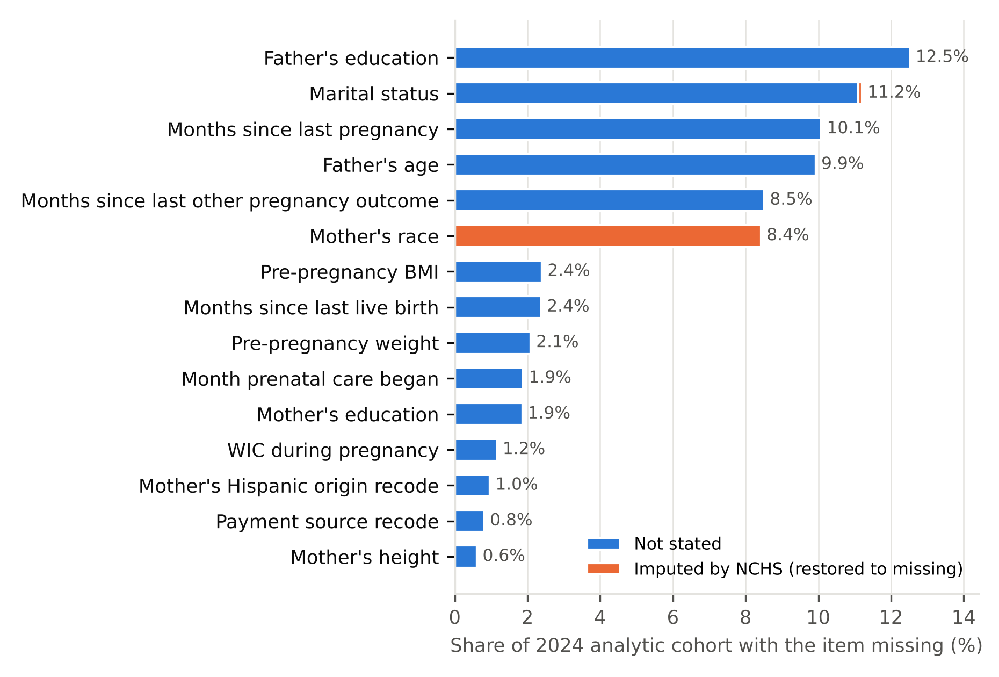
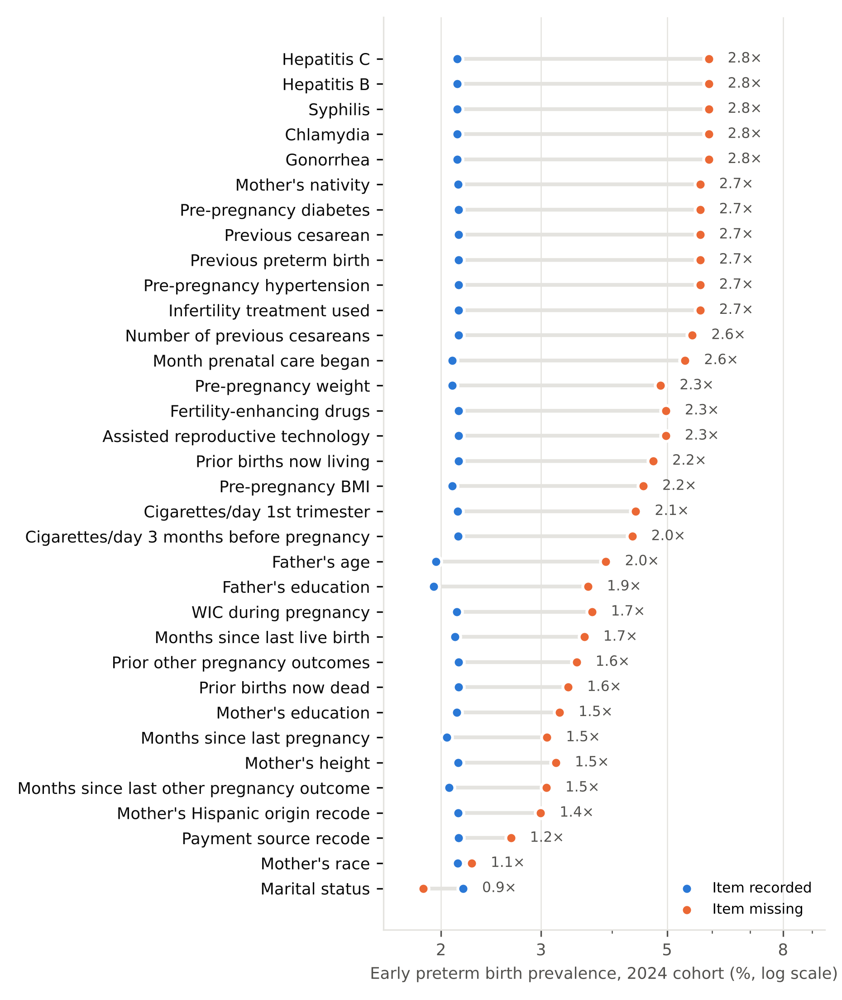
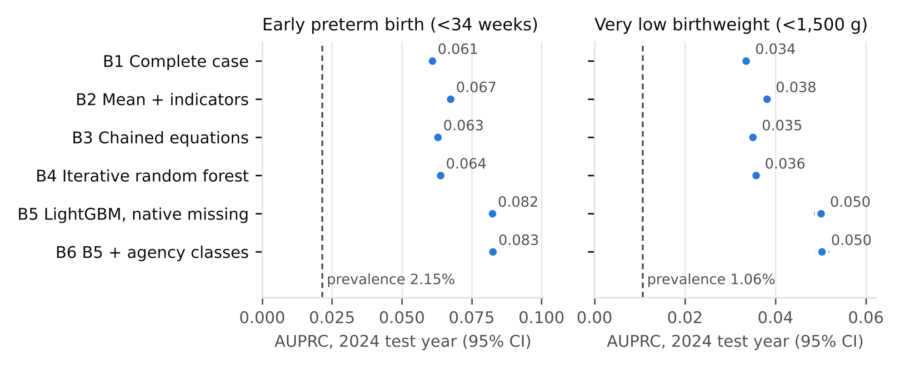

# PH-MissBench: rare-outcome prediction tasks with real, agency-documented missingness from U.S. birth records

**Selorm Buaka**
PhD Student, Applied Statistics and Research Methods, University of Northern Colorado, Greeley, Colorado, USA
ORCID [0009-0005-3991-4859](https://orcid.org/0009-0005-3991-4859) · othnielbuaka@gmail.com

**Keywords:** missing data; benchmark; imputation; natality; preterm birth; low birthweight; public health surveillance

## Abstract

**Background.** Missing-data methods are usually compared on complete datasets with values deleted by simulation, which fixes the missingness mechanism by design. How methods behave on the missingness that public health analysts actually face is less well studied, particularly for rare outcomes.

**Methods.** PH-MissBench is an open benchmark built from U.S. National Center for Health Statistics (NCHS) natality public-use files for 2022–2024. Every predictor cell carries the missingness class documented by NCHS (observed, not stated, structurally not applicable, or imputed by NCHS), and NCHS-imputed values are restored to missing. Two tasks predict early preterm birth (obstetric-estimate gestation under 34 weeks) and very low birthweight (under 1,500 g) among singleton births to U.S. residents from 35 pre-pregnancy and prenatal items, with training on 2022–2023 and testing on 2024. Task files were hashed and frozen before any baseline was run. Six baselines were evaluated by area under the precision-recall curve (AUPRC) with 1,000-replicate stratified bootstrap intervals.

**Results.** The cohort comprised 6,324,305 training, 703,612 validation and 3,512,264 test births; test-year prevalence was 2.15% for early preterm birth and 1.06% for very low birthweight. The pipeline reproduced NCHS published birth totals exactly for all three years. In 2024, 38.23% of births had at least one predictor missing. Gradient boosting with native missing-value handling performed best (AUPRC 0.082 and 0.050); mean imputation with missing-value indicators (0.067, 0.038) outperformed chained-equations (0.063, 0.035) and iterative random-forest imputation (0.064, 0.036); complete-case analysis performed worst (0.061, 0.034) and was miscalibrated.

**Conclusions.** On population-scale U.S. birth records, approaches that let the model see missingness outperformed imputation alone, consistent with informative missingness. PH-MissBench provides frozen, reproducible tasks for comparing missing-data methods on real public health data.

## 1. Introduction

Missing data are routine in public health records, and the methods used to handle them change which predictions a model can make and for whom. Most comparisons of missing-data methods start from a complete dataset and delete values by a chosen mechanism (missing completely at random, at random, or not at random [6]) [1, 2]. That design gives a ground truth for the deleted values, but it fixes the missingness mechanism by assumption; in real records the mechanism is unknown and often related to the outcome. Studies that instead use naturally occurring missingness in health databases have found that conclusions differ: gradient-boosted trees that handle missing values natively, and models given missing-value indicators, often predict as well as or better than models trained after imputation [3, 4], consistent with theory showing that good prediction does not require good imputation [5]. Those studies drew on a small number of clinical cohorts and did not distinguish between the reasons a value is absent.

U.S. vital statistics and survey files document why values are absent: an item may be not stated, structurally not applicable (a birth interval for a first birth), or filled in by the producing agency's own imputation. PH-MissBench uses that documentation to build prediction tasks on rare outcomes, where missing-data errors are costly because positives are few, and releases the agency-documented missingness class of every cell. Agency-imputed values are restored to missing, so that methods are not silently credited with the agency's imputation. This paper describes the first module, built from U.S. birth records, and reports baseline results.

## 2. Methods

### 2.1 Data source
The source is the NCHS Natality Public Use Files for data years 2022, 2023 and 2024, which contain one fixed-width record for every birth registered in the United States [12]. Files are downloaded by the released scripts, which log file size and SHA-256 hash for each file. Record positions follow the NCHS user guide for each year and are validated automatically: a field fails if more than 0.1% of its values fall outside the documented code set.

### 2.2 Analytic cohort
Records were restricted to births to U.S. residents, to records whose plurality was reported rather than imputed by NCHS, and to singletons (Table 1). Records with the outcome not stated are excluded from that task and counted.

**Table 1.** Cohort flow by data year.

| Stage | 2022 | 2023 | 2024 |
|---|---:|---:|---:|
| All records | 3,676,029 | 3,605,081 | 3,638,436 |
| U.S. residents | 3,667,758 | 3,596,017 | 3,628,934 |
| Plurality not imputed | 3,667,586 | 3,595,878 | 3,627,336 |
| Singletons (analytic cohort) | 3,550,208 | 3,482,832 | 3,515,553 |
| Early preterm: outcome stated | 3,547,629 | 3,480,288 | 3,512,264 |
| Early preterm: cases | 76,705 | 75,408 | 75,567 |
| Very low birthweight: outcome stated | 3,547,547 | 3,480,218 | 3,512,859 |
| Very low birthweight: cases | 38,376 | 37,533 | 37,336 |

### 2.3 Outcomes
Early preterm birth (primary task): obstetric estimate of gestation under 34 completed weeks. The obstetric estimate has been the NCHS standard measure since 2014 and is not imputed; the LMP-based combined gestation is not used because NCHS imputes some of its values. Very low birthweight (secondary task): birthweight under 1,500 g.

### 2.4 Predictors and prediction timepoint
The predictors are 35 pre-pregnancy and prenatal fields (Appendix Table A1): maternal and paternal demographics, reproductive history and inter-pregnancy intervals, month prenatal care began, WIC participation, cigarette smoking before pregnancy and in the first trimester, maternal height, pre-pregnancy weight and BMI, pre-existing diabetes and hypertension, previous preterm birth, infertility treatment, previous cesarean delivery, and maternal infections. The number of prenatal visits and all labor, delivery and infant items are excluded because they are recorded through or after delivery. Gestational hypertension, eclampsia, gestational diabetes, and second- and third-trimester smoking are also excluded: they are recorded at delivery without a diagnosis date, and missingness of third-trimester smoking is itself strongly associated with early delivery (in the 2024 cohort, early preterm prevalence was 52.02% where it was missing versus 1.73% where recorded).

### 2.5 Missingness classes
Each predictor cell is assigned one class: observed; not stated (the agency's unknown code); not applicable (a structural code, for example birth intervals for a first birth or fertility-drug use when no infertility treatment was reported); imputed by NCHS (identified from the NCHS imputation flags for mother's age, race and marital status); or undocumented code (a value outside the documented code set, treated as missing). Not-stated, imputed and undocumented cells are missing in the task files. Structural not-applicable cells are encoded explicitly, as a category for categorical fields and as an indicator column for numeric fields, because they are known rather than missing. The class of every cell is released in companion files.

### 2.6 Splits
Births from 2022–2023 form the training years, with a seeded 10% validation hold-out; births from 2024 form the test set, so that evaluation also reflects temporal drift. Splits are assigned once at the cohort level (seed 20261004), so both tasks share them. A standard track uses a seeded 250,000-record training subsample, so that computationally heavy methods can be compared; a full track uses all training records. Natality files are a census of registered births, so no sampling weights apply.

### 2.7 Baselines
All logistic-regression baselines standardize features and use L2 regularization (C = 1); categorical fields are one-hot encoded. For B1–B4, structural not-applicable numeric cells are set to zero with their indicator retained.

- **B1, complete case.** Logistic regression trained only on training records with no missing predictor; at prediction time, missing cells are filled with training medians.
- **B2, mean imputation with indicators.** Median fill plus one missing-value indicator per field, then logistic regression.
- **B3, chained equations.** Single imputation by chained equations [7] (Bayesian ridge, 10 iterations), then logistic regression. This is single, not multiple, imputation.
- **B4, iterative random forest.** Iterative imputation with a random-forest estimator in the style of missForest [8] (20 trees, maximum depth 12, 5 iterations), then logistic regression. Standard track only.
- **B5, gradient boosting.** LightGBM [9] with native missing-value handling (learning rate 0.03, 31 leaves, minimum 100 records per leaf, 0.8 row and column subsampling), early-stopped on validation AUPRC with patience 100.
- **B6, gradient boosting with agency classes.** B5 plus two indicators per field marking not-stated and NCHS-imputed cells.

The B3 and B4 imputers are fit on a seeded 50,000-record subsample of the training data and then applied to all records. Hyperparameters are fixed defaults, not tuned.

### 2.8 Evaluation
The primary metric is AUPRC on the 2024 test set, which is more informative than the area under the ROC curve (AUROC) when positives are rare [10]. Secondary metrics are AUROC, the Brier score, the calibration slope, and calibration-in-the-large (the intercept with the model's logit as an offset) [11]. Uncertainty is summarized by 95% percentile intervals from 1,000 stratified bootstrap replicates of the test set, resampling cases and non-cases separately. AUPRC is computed as average precision. The fast implementation used for the bootstrap is checked against scikit-learn on every run.

### 2.9 Freeze and independence
After the cohort, predictors and splits were fixed, the task files, split manifest and record layout were hashed (SHA-256) and recorded in `FREEZE.json` on 2026-10-10, before any baseline or author-developed method was evaluated. The baseline code refuses to run if any task file differs from its frozen hash. Any later change to the tasks is released as a new benchmark version.

### 2.10 Software
Python 3.13.16, pandas 3.0.5, pyarrow 25.0.1, NumPy 2.5.3, scikit-learn 1.9.1 and LightGBM 4.7.0.

## 3. Results

### 3.1 Cohort and outcomes
The analytic cohort comprised 3,550,208, 3,482,832 and 3,515,553 singleton births in 2022, 2023 and 2024 (Table 1). For early preterm birth, the task contains 6,324,305 training, 703,612 validation and 3,512,264 test records (75,567 test cases; prevalence 2.15%). For very low birthweight, the test set has 37,336 cases (prevalence 1.06%).

### 3.2 External validation
The pipeline's counts of births to U.S. residents were 3,667,758 (2022), 3,596,017 (2023) and 3,628,934 (2024), identical to the totals published by NCHS [13]. Recomputed across all 2024 births, early preterm birth was 2.72% and very low birthweight 1.33%, matching the published 2.72% and 1.33%. All 55 extracted fields passed the layout check in every year. One 2024 record carried an undocumented blank in two birth-interval fields and was treated as missing.

### 3.3 Missingness
In the 2024 cohort, 38.23% of births had at least one predictor missing, with a mean of 0.80 missing predictors per birth (Figure 1). The most frequently missing items were father's education (12.5%), marital status (11.1% not stated, a group that includes births to California residents, for whom NCHS withholds marital status, and 0.1% imputed), the interval since the last pregnancy (10.1%) and father's age (9.9%). Mother's race was imputed by NCHS for 8.4% of births; these values are missing in the benchmark.

Missingness was informative (Figure 2). Early preterm prevalence was 2.8 times higher among births with the maternal infection items missing than among births with them recorded, 2.6 times higher when the month prenatal care began was missing, and 2.2 times higher when pre-pregnancy BMI was missing. Marital status was the exception (ratio 0.9), consistent with its missingness being driven largely by California's statutory withholding rather than by the circumstances of the birth.

### 3.4 Baseline results
Table 2 and Figure 3 report test-set results on the standard track.

::: {.keep}
**Table 2.** Baseline results on the 2024 test year (standard track, 250,000 training births).

| Task | Model | AUPRC (95% CI) | AUROC (95% CI) | Slope | Intercept |
|---|---|---|---|---:|---:|
| EPTB | B1 | 0.061 (0.060–0.062) | 0.695 (0.693–0.697) | 0.91 | 0.13 |
| EPTB | B2 | 0.067 (0.066–0.069) | 0.711 (0.709–0.713) | 0.94 | 0.00 |
| EPTB | B3 | 0.063 (0.062–0.064) | 0.701 (0.699–0.703) | 0.94 | 0.00 |
| EPTB | B4 | 0.064 (0.063–0.065) | 0.703 (0.701–0.705) | 0.94 | 0.00 |
| EPTB | B5 | 0.082 (0.081–0.084) | 0.737 (0.735–0.739) | 1.01 | 0.00 |
| EPTB | B6 | 0.083 (0.081–0.084) | 0.737 (0.735–0.739) | 1.01 | 0.00 |
| VLBW | B1 | 0.034 (0.033–0.034) | 0.714 (0.711–0.717) | 0.93 | 0.11 |
| VLBW | B2 | 0.038 (0.037–0.039) | 0.731 (0.729–0.734) | 0.96 | -0.02 |
| VLBW | B3 | 0.035 (0.034–0.036) | 0.721 (0.719–0.724) | 0.96 | -0.02 |
| VLBW | B4 | 0.036 (0.035–0.037) | 0.724 (0.722–0.727) | 0.96 | -0.02 |
| VLBW | B5 | 0.050 (0.049–0.052) | 0.755 (0.753–0.758) | 0.96 | -0.01 |
| VLBW | B6 | 0.050 (0.049–0.052) | 0.756 (0.753–0.758) | 1.00 | -0.01 |

Slope and intercept: calibration slope and calibration-in-the-large. Brier scores are in `paper/baselines_standard.csv`.

:::
B1 complete-case logistic regression; B2 mean imputation with missing-value indicators; B3 chained-equations single imputation [7]; B4 iterative random-forest imputation [8]; B5 LightGBM with native missing-value handling [9]; B6 B5 plus agency missingness-class indicators.

Gradient boosting with native missing-value handling (B5) ranked first on both tasks, with AUPRC 0.082 for early preterm birth (3.8 times the prevalence) and 0.050 for very low birthweight (4.7 times). Mean imputation with missing-value indicators (B2) outperformed both iterative imputers on both tasks. Complete-case analysis (B1) ranked last; only 153,461 of 250,000 training births had every predictor recorded, and its predictions were systematically too low (calibration-in-the-large 0.13 and 0.11). Adding agency missingness classes to gradient boosting (B6) did not change discrimination. All other baselines were close to well calibrated (slopes 0.94–1.01).

## 4. Discussion

On population-scale U.S. birth records, methods that let the model see missingness (gradient boosting with native handling, and indicator columns) outperformed imputation without indicators, and complete-case analysis performed worst. This ordering replicates findings from clinical databases [3] and theory on prediction with missing values [4, 5], here on several million births and with the agency's own record of why each value is missing. The audit points to the mechanism: for 20 of the 34 predictors with at least 1,000 missing records, births with the item missing had at least twice the early preterm prevalence of births with it recorded (median ratio 2.2), so missingness itself carries information that imputation alone discards. The near-identical performance of B5 and B6 suggests that, for gradient boosting, knowing that a value is missing matters more than knowing why. Whether the distinction between not-stated and agency-imputed values matters for other method families is a question the benchmark is designed to answer.

The practical implication for public health analysts working with vital records is that dropping incomplete records is the worst default: it discarded 39% of the training data here, lost discrimination, and biased the predicted risk. Imputation without missing-value indicators also lost information relative to simple indicator methods.

**Limitations.** There is no ground truth for the missing values, so the benchmark scores prediction rather than reconstruction. Missingness mechanisms are unknown; the classes record what NCHS documented, not whether data are missing at random. NCHS flags imputation for only a few items, so undocumented edits to other items cannot be reversed. Marital status for California births is withheld by statute and cannot be separated from ordinary non-response because the public files carry no geography. Pregnancy conditions are recorded without diagnosis dates, so the prediction timepoint rests on judgment, and the most clearly late-pregnancy items were excluded. Baselines use fixed default hyperparameters and only the standard training track; B3 is single rather than multiple imputation. Absolute performance is modest, as expected for prediction from pre-pregnancy and prenatal certificate items alone; the tasks are designed for comparing methods, not for clinical use.

**Future work.** Planned modules add survey data (YRBS, BRFSS, NHANES and NSDUH), which require design-aware splits and weighted metrics, along with full-track baselines, multiple imputation with pooling, and a separate late-pregnancy predictor tier.

## 5. Usage notes
Users rebuild the tasks from the NCHS files with `run_all.sh` (about 900 MB of downloads); the raw records are not redistributed. Methods should tune only on the validation split, report test metrics once per configuration, and report both training tracks where feasible.

## Code and data availability
The code (MIT License) and the task definitions, split manifests, missingness audit and baseline results (CC BY 4.0) are available at https://github.com/SelormB/ph-missbench. An archived release with a Zenodo DOI will follow. The task files were frozen and tagged (`tasks-frozen-v1.0`) on 2026-10-10. The underlying records are the NCHS Natality Public Use Files, which are publicly available subject to NCHS data-use restrictions.

## Declarations
**Funding.** This work received no specific grant from any funding agency.

**Ethics.** This study used only de-identified, publicly available data (NCHS Natality Public Use Files) and therefore does not meet the definition of human subjects research under 45 CFR 46.102. It was not submitted for institutional review board review. No attempt was made to identify any individual, in accordance with the NCHS data-use restrictions.

**Author contributions (CRediT).** Selorm Buaka: Conceptualization; Methodology; Project administration.

**Use of AI assistance.** The author conceived the benchmark and made its design decisions (cohort, outcomes, prediction timepoint, predictor exclusions and split design). An AI assistant (Claude, Anthropic) wrote the pipeline code, ran the analyses, and drafted this manuscript, including its text, figures and tables. Every number in the manuscript is generated programmatically from the released pipeline outputs.

## References
1. Jäger S, Allhorn A, Bießmann F. A benchmark for data imputation methods. Front Big Data. 2021;4:693674. doi:10.3389/fdata.2021.693674
2. Jarrett D, Cebere BC, Liu T, Curth A, van der Schaar M. HyperImpute: generalized iterative imputation with automatic model selection. In: Proceedings of the 39th International Conference on Machine Learning. PMLR. 2022;162:9916–9937.
3. Perez-Lebel A, Varoquaux G, Le Morvan M, Josse J, Poline JB. Benchmarking missing-values approaches for predictive models on health databases. GigaScience. 2022;11:giac013. doi:10.1093/gigascience/giac013
4. Le Morvan M, Varoquaux G. Imputation for prediction: beware of diminishing returns. In: International Conference on Learning Representations (ICLR). 2025. arXiv:2407.19804
5. Josse J, Chen JM, Prost N, Scornet E, Varoquaux G. On the consistency of supervised learning with missing values. arXiv:1902.06931 [stat.ML]. doi:10.48550/arXiv.1902.06931
6. Rubin DB. Inference and missing data. Biometrika. 1976;63(3):581–592.
7. van Buuren S, Groothuis-Oudshoorn K. mice: Multivariate imputation by chained equations in R. J Stat Softw. 2011;45(3):1–67.
8. Stekhoven DJ, Bühlmann P. MissForest—non-parametric missing value imputation for mixed-type data. Bioinformatics. 2012;28(1):112–118.
9. Ke G, Meng Q, Finley T, et al. LightGBM: a highly efficient gradient boosting decision tree. Adv Neural Inf Process Syst. 2017;30:3146–3154.
10. Saito T, Rehmsmeier M. The precision-recall plot is more informative than the ROC plot when evaluating binary classifiers on imbalanced datasets. PLoS One. 2015;10(3):e0118432.
11. Van Calster B, McLernon DJ, van Smeden M, Wynants L, Steyerberg EW. Calibration: the Achilles heel of predictive analytics. BMC Med. 2019;17:230.
12. National Center for Health Statistics. User guide to the 2022, 2023 and 2024 natality public use files. Hyattsville, MD: NCHS. https://www.cdc.gov/nchs/data_access/vitalstatsonline.htm
13. Osterman MJK, Hamilton BE, Martin JA, Driscoll AK, Valenzuela CP. Births: final data for 2024. Natl Vital Stat Rep. 2026;75(2). Hyattsville, MD: National Center for Health Statistics.

::: {.appendix}
## Appendix

**Table A1.** Predictors and their missingness in the 2024 analytic cohort, by class.

| Field | Description | Not stated (%) | NCHS-imputed (%) | Not applicable (%) |
|---|---|---:|---:|---:|
| `MAGER` | Mother's age | 0.00 | 0.01 | 0.00 |
| `MBSTATE_REC` | Mother's nativity | 0.21 | 0.00 | 0.00 |
| `MRACE6` | Mother's race | 0.00 | 8.43 | 0.00 |
| `MHISP_R` | Mother's Hispanic origin recode | 0.97 | 0.00 | 0.00 |
| `DMAR` | Marital status | 11.11 | 0.10 | 0.00 |
| `MEDUC` | Mother's education | 1.86 | 0.00 | 0.00 |
| `FAGECOMB` | Father's age | 9.93 | 0.00 | 0.00 |
| `FEDUC` | Father's education | 12.53 | 0.00 | 0.00 |
| `PRIORLIVE` | Prior births now living | 0.23 | 0.00 | 0.00 |
| `PRIORDEAD` | Prior births now dead | 0.35 | 0.00 | 0.00 |
| `PRIORTERM` | Prior other pregnancy outcomes | 0.43 | 0.00 | 0.00 |
| `ILLB_R` | Months since last live birth | 2.38 | 0.00 | 40.38 |
| `ILOP_R` | Months since last other pregnancy outcome | 8.52 | 0.00 | 71.68 |
| `ILP_R` | Months since last pregnancy | 10.09 | 0.00 | 32.73 |
| `PRECARE` | Month prenatal care began | 1.89 | 0.00 | 0.00 |
| `WIC` | WIC during pregnancy | 1.17 | 0.00 | 0.00 |
| `CIG_0` | Cigarettes/day 3 months before pregnancy | 0.46 | 0.00 | 0.00 |
| `CIG_1` | Cigarettes/day 1st trimester | 0.45 | 0.00 | 0.00 |
| `M_HT_IN` | Mother's height | 0.61 | 0.00 | 0.00 |
| `BMI` | Pre-pregnancy BMI | 2.40 | 0.00 | 0.00 |
| `PWGT_R` | Pre-pregnancy weight | 2.09 | 0.00 | 0.00 |
| `RF_PDIAB` | Pre-pregnancy diabetes | 0.17 | 0.00 | 0.00 |
| `RF_PHYPE` | Pre-pregnancy hypertension | 0.17 | 0.00 | 0.00 |
| `RF_PPTERM` | Previous preterm birth | 0.17 | 0.00 | 0.00 |
| `RF_INFTR` | Infertility treatment used | 0.17 | 0.00 | 0.00 |
| `RF_FEDRG` | Fertility-enhancing drugs | 0.23 | 0.00 | 97.51 |
| `RF_ARTEC` | Assisted reproductive technology | 0.23 | 0.00 | 97.51 |
| `RF_CESAR` | Previous cesarean | 0.17 | 0.00 | 0.00 |
| `RF_CESARN` | Number of previous cesareans | 0.18 | 0.00 | 0.00 |
| `IP_GON` | Gonorrhea | 0.39 | 0.00 | 0.00 |
| `IP_SYPH` | Syphilis | 0.39 | 0.00 | 0.00 |
| `IP_CHLAM` | Chlamydia | 0.39 | 0.00 | 0.00 |
| `IP_HEPB` | Hepatitis B | 0.39 | 0.00 | 0.00 |
| `IP_HEPC` | Hepatitis C | 0.39 | 0.00 | 0.00 |
| `PAY_REC` | Payment source recode | 0.82 | 0.00 | 0.00 |

:::
